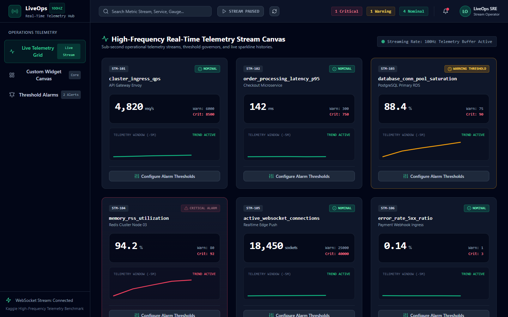
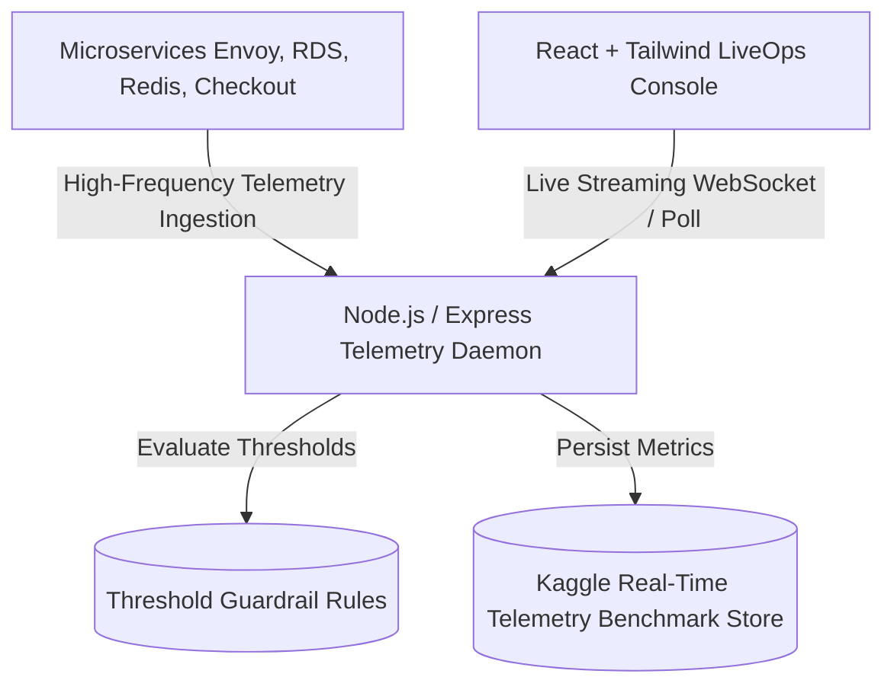

# LiveOps — Real-Time Telemetry & Operations Dashboard

[](LICENSE)
[](https://nodejs.org/)
[](https://react.dev/)
[](https://tailwindcss.com/)
[](data/kaggle_liveops_telemetry_benchmark.csv)
[](https://www.docker.com/)

LiveOps is a high-frequency real-time operations dashboard designed for cloud microservices, gaming backends, payment gateways, and Kubernetes cluster telemetry. It features sub-second WebSocket streams, interactive threshold guardrails, and customizable widget canvases.

---

## 📸 System Dashboard & Telemetry Stream Canvas



---

## 🌟 Key Capabilities & Standout Features

- **High-Frequency Metric Streams**: Sub-second telemetry ingestion tracking ingress QPS, P95 database latencies, connection pool saturation, and Redis RSS memory usage.
- **Dynamic Threshold Guardrails**: Configurable Warning and Critical thresholds with instant visual alerts and alarm state machines (`NOMINAL`, `WARNING_THRESHOLD`, `CRITICAL_ALARM`).
- **Interactive Custom Widget Canvas**: Add custom metric streams and reorder telemetry cards on the fly.
- **Real-Time Sparkline History**: Continuous rendering of historical trends and anomaly spikes over sliding temporal windows.
- **WebSocket Streaming Simulation**: Built-in jitter tick generator allowing SREs to simulate traffic bursts and recovery curves.

---

## 🏛 Architecture Overview



---

## 📊 Dataset Benchmark

The repository includes a curated benchmark in [`data/kaggle_liveops_telemetry_benchmark.csv`](data/kaggle_liveops_telemetry_benchmark.csv) covering:
- `stream_id`: Unique stream identifier (e.g., `STM-101`)
- `metric_key` & `source_service`: Ingress QPS, latency P95, DB connection pool, and Redis RSS memory
- `current_value` & `unit`: Quantitative measurement
- `threshold_warning` & `threshold_critical`: Operational guardrail thresholds
- `alarm_status`: `NOMINAL`, `WARNING_THRESHOLD`, or `CRITICAL_ALARM`
- `p95_value` & `historical_trend_direction`: Trend dynamics (`RISING`, `STABLE`, `SPIKING`)

---

## 🔌 API Reference

| Endpoint | Method | Description |
| :--- | :--- | :--- |
| `/health` | `GET` | Health check & stream daemon status |
| `/api/v1/telemetry/summary` | `GET` | Aggregated cluster stream counts, alarm distributions, and health score |
| `/api/v1/telemetry/streams` | `GET` | List all active telemetry feeds with sparkline histories |
| `/api/v1/telemetry/simulate-tick` | `POST` | Emit a real-time jittered telemetry tick across all active streams |

---

## 🚀 Quickstart Guide

### Option 1: Docker Compose (Recommended)

```bash
docker-compose up --build
```
- Web Application: `http://localhost:3010`
- Backend API: `http://localhost:5006`

### Option 2: Local Development

#### 1. Backend Service
```bash
cd backend
npm install
npm run dev
```

#### 2. Frontend Application
```bash
cd frontend
npm install
npm run dev
```

---

## 📄 License
This project is licensed under the MIT License.
